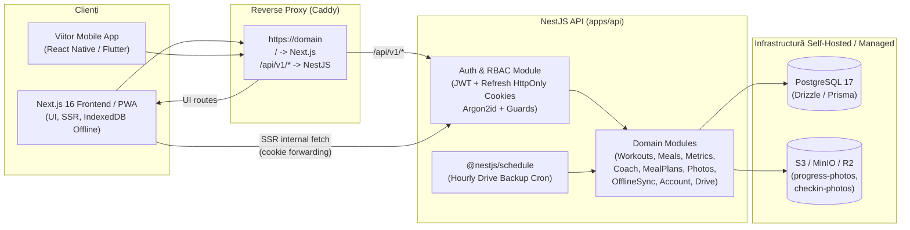

# Plan de Arhitectură și Migrare: Decuplare RepLog în Backend NestJS + PostgreSQL & Frontend Next.js

## 1. Evaluare de Fezabilitate

Aplicația **RepLog (`nova2`)** este un candidat excelent pentru decuplarea de Supabase într-un backend dedicat **NestJS + PostgreSQL + S3/MinIO**, păstrând **Next.js 16** strict ca strat de frontend/PWA.

### De ce migrarea este curată și fezabilă
- **Schema PostgreSQL (29 tabele)** folosește doar SQL standard (tabele, FK-uri, indecși, trigger-e), fără funcționalități proprietare Supabase (nu folosim Realtime, Edge Functions, Studio sau imgproxy). Singura legătură cu schema Supabase este FK-ul către `auth.users(id)` și cele 2 bucket-uri private din Storage.
- **Logica pură de domeniu din `lib/`** (`energy.ts`, `plateau.ts`, `personal-record.ts`, `strength-progression.ts`, `daily-metrics.ts`, `checkin.ts`, `coach/analytics.ts`, `coach/programs.ts`, `coach/meal-plans.ts`, `coach/interactions.ts`, `offline/model.ts`, `units.ts`) are **0 dependențe de Supabase** și poate fi extrasă într-un pachet comun (`packages/shared`) utilizat de ambele aplicații (NestJS și Next.js).
- **Suprafața client-side este foarte mică**: doar **8 componente `"use client"`** apelează direct browser-client-ul Supabase (`utils/supabase/client.ts`); restul apelurilor sunt deja server-side (Server Components, Server Actions, Route Handlers).

> **Context important (riscul „dacă dispare Supabase Cloud”):**
> RepLog are deja [docker-compose.yml](../docker-compose.yml) cu **Supabase self-hosted open-source** (`postgres` + `gotrue` + `postgrest` + `storage-api`), deci aplicația nu depinde de Supabase Cloud pentru a rula pe un VPS propriu.
>
> Migrarea la **NestJS + PostgreSQL + S3/MinIO** aduce însă beneficii strategice majore:
> 1. **API REST/OpenAPI adevărat** — gata pentru o aplicație mobilă nativă (React Native / Flutter / Swift / Kotlin), webhooks sau integrări terțe.
> 2. **Eliminarea limitărilor PostgREST/RLS** — fără limita de 1000 rânduri per query, fără riscuri de recursie în politici RLS, fără duplicare de validări între PL/pgSQL și TypeScript.
> 3. **Separare strictă Frontend / Backend** — Next.js nu mai deține chei `service_role`, conexiuni directe la DB sau joburi cron; devine strict stratul UI + PWA offline.

---

## 2. Arhitectura Țintă



---

## 3. Inventarul Dependențelor Supabase din Codul Actual

### 3.1. Fișiere care referențiază Supabase (68 fișiere totale)

| Categorie | Nr. fișiere | Fișiere reprezentative |
|---|---:|---|
| **Browser Supabase Client** (`utils/supabase/client.ts`) | **8** | `app/insert/page.tsx`, `app/stats/page.tsx`, `app/meals/history/page.tsx`, `app/meals/progress/page.tsx`, `app/photos/photo-gallery.tsx`, `app/checkin/weekly/weekly-checkin-client.tsx`, `app/components/sign-out-button.tsx`, `lib/offline/client.tsx` |
| **Server Actions** (`"use server"`) | **19** | `app/insert/action.ts`, `app/meals/action.ts`, `app/meals/plan/actions.ts`, `app/coach/programs/actions.ts`, `app/coach/meal-plans/actions.ts`, `app/coach/clients/actions.ts`, `app/checkin/weekly/actions.ts`, `app/explore/actions.ts`, `app/settings/actions.ts`, `app/login/action.ts`, `app/register/actions.ts`, etc. |
| **Next.js API Routes** (`app/api/**/route.ts`) | **16** | `account/export`, `account/import`, `drive/*` (10 rute), `food/search`, `food/barcode/[code]`, `notifications/unread`, `offline` |
| **Server Components & Helpers** | **25** | `app/page.tsx`, `app/layout.tsx`, `proxy.ts`, `app/coach/**`, `app/meals/**`, `lib/account-export.ts`, `lib/drive-service.ts`, `lib/foods.ts`, `lib/photos.ts`, `lib/checkin-photos.ts` |

### 3.2. Tabele PostgreSQL (29 tabele)
- **Identitate & profil**: `profiles`, `coach_profiles` *(+ tabele noi în NestJS: `users`, `refresh_tokens` în locul `auth.users`)*
- **Antrenamente**: `workouts`, `workout_sets`, `cardio_sessions`, `workout_drafts`
- **Nutriție**: `foods`, `meals`, `meal_items`, `meal_templates`, `user_targets`
- **Metrici & progres**: `daily_steps`, `daily_weight`, `daily_checkin`, `progress_photos`
- **Coaching & Programe**: `programs`, `program_workouts`, `program_workout_exercises`, `program_workout_cardio`, `enrollments`, `coach_client_notes`, `workout_feedback`, `weekly_checkins`, `notifications`
- **Planuri alimentare Coach**: `meal_plans`, `meal_plan_days`, `meal_plan_meals`, `meal_plan_items`
- **Sync & Backup**: `offline_sync_receipts`, `google_drive_backups`

### 3.3. Funcții RPC SQL (14 funcții) -> Servicii NestJS

| RPC actual în Postgres | Echivalent în NestJS |
|---|---|
| `save_workout` / `update_workout` | `WorkoutsService.create()` / `.update()` (tranzacție + detecție PR + notificare coach) |
| `sync_offline_entry` | `OfflineSyncService.syncMutation()` (tranzacție + advisory lock + idempotency key în `offline_sync_receipts`) |
| `activate_coach_role` | `AuthService.activateCoachRole()` |
| `preview_program_by_invite` / `enroll_in_program` | `ExploreService.previewByInvite()` / `.enroll()` |
| `clone_program_for_client` | `ProgramsService.cloneForClient()` |
| `review_weekly_checkin` | `WeeklyCheckinsService.review()` |
| `clone_meal_plan_for_client` / `notify_meal_plan_updated` / `get_shared_meal_plan` | `MealPlansService.cloneForClient()` / `.notifyUpdated()` / `.getPublicByToken()` |
| `import_my_data` / `delete_my_data` | `AccountService.importData()` / `.deleteAllData()` (cu ștergere prealabilă din S3/MinIO) |

### 3.4. Storage (2 bucket-uri private)
- `progress-photos`: `<user_id>/<uuid>.jpg`, limită 200 poze/user, JPEG max 5 MB.
- `checkin-photos`: `<client_id>/<uuid>.jpg`, 3 sloturi (`front`, `back`, `side`), vizibil doar clientului și antrenorului activ.

---

## 4. Structura Monorepo Propuse

Recomandare: **Monorepo (`pnpm workspaces`)** pentru a partaja tipurile, DTO-urile și logica pură din `lib/` între backend și frontend fără duplicare.

```text
nova2/
├── apps/
│   ├── web/                     # Aplicația Next.js 16 actuală (strict UI + PWA + SSR subțire)
│   └── api/                     # Backend NestJS 11 + Swagger + PostgreSQL + S3/MinIO
│       └── src/
│           ├── main.ts          # Global ValidationPipe, Helmet, CORS, CookieParser, Swagger (/api/docs)
│           ├── common/          # JwtAuthGuard, CoachGuard, ActiveCoachAccessGuard, Decorators, Filters
│           ├── database/        # Drizzle ORM / Prisma + Postgres pool
│           ├── storage/         # @aws-sdk/client-s3 adapter (MinIO / Cloudflare R2 / AWS S3)
│           └── modules/
│               ├── auth/        # Register, Login, Refresh, Logout, Password, Activate Coach Role
│               ├── profiles/    # Profile, units, language, daily step goal, coach_profiles
│               ├── workouts/    # Workouts, sets, cardio, drafts, PR detection, history, records, stats
│               ├── meals/       # Meals, items, templates, targets, energy metrics
│               ├── foods/       # Local DB + Open Food Facts + USDA search & shared barcode catalog
│               ├── metrics/     # Daily steps, daily weight, daily check-ins
│               ├── photos/      # Progress photos (cap 200) + presigned URLs
│               ├── coach/       # Clients, enrollments, programs, feedback, weekly check-ins + photos
│               ├── meal-plans/  # Coach meal plans CRUD, clone, public token endpoint, client log/apply
│               ├── notifications/ # Unread count, list, mark read, delete
│               ├── offline/     # Atomic idempotent mutation replay (/api/v1/offline/sync)
│               ├── account/     # GDPR JSON export, import, full data & account deletion
│               └── drive/       # Google Drive OAuth, AES-GCM tokens, manual/auto backup & @nestjs/schedule
├── packages/
│   └── shared/                  # Logică pură + tipuri + validări partajate (mutat din lib/)
└── docker-compose.yml           # postgres:17-alpine + minio + api (NestJS) + web (Next.js) + caddy
```

---

## 5. Decizii Tehnice Recomandate

1. **ORM / Query Layer**: **Drizzle ORM** (SQL-first, zero overhead, permite păstrarea migrațiilor SQL existente aproape 1:1) sau **Prisma** (dacă preferi schema declarativă și generare automată de tipuri).
2. **Autentificare & Sesiuni**:
   - Parole hash-uite cu **Argon2id** (plus compatibilitate `bcrypt` la primul login dacă se migrează conturi existente din Supabase `auth.users.encrypted_password`, cu re-hash automat la Argon2id — zero resetări de parolă).
   - **JWT Access Token** scurt (15 min) + **Refresh Token rotativ** (30 zile, hash-uit în `refresh_tokens`) livrate în cookie-uri `HttpOnly; Secure; SameSite=Lax` pentru Web SSR + suport `Authorization: Bearer <token>` pentru o viitoare aplicație mobilă.
3. **Autorizare (înlocuirea RLS)**:
   - `JwtAuthGuard` + `CoachGuard` + `ActiveCoachAccessGuard` în NestJS.
   - Fiecare serviciu filtrează explicit după `userId` din JWT (sau prin serviciul de autorizare coach-client), dublat de o suită de teste E2E de izolare între utilizatori.
4. **Object Storage**:
   - Adapter unic prin `@aws-sdk/client-s3` (funcționează identic cu **MinIO self-hosted** în Docker și cu **Cloudflare R2 / AWS S3** doar din variabile de mediu).
   - Upload direct cu **presigned PUT URL** (păstrând redimensionarea la 1600px JPEG în browser) și afișare cu **presigned GET URLs** (expirare 10 min).

---

## 6. Plan de Migrare pe Faze (Zero Downtime / Strangler Fig)

### Faza 0 — Pregătire Monorepo & `packages/shared`
- Configurare `pnpm-workspace.yaml` cu `apps/web`, `apps/api`, `packages/shared`.
- Mutarea modulelor pure din `lib/` (fără dependențe Next/Supabase) în `packages/shared`, păstrând toate testele unitare existente verzi.

### Faza 1 — Schelet NestJS + PostgreSQL + Auth & RBAC
- Inițializare `apps/api` (NestJS 11, Swagger `/api/docs`, Helmet, ValidationPipe, rate limiting).
- Creare schema Postgres independentă de Supabase (`public.users`, `public.refresh_tokens` + toate cele 29 tabele cu FK spre `public.users(id)`).
- Implementare `AuthModule`:
  - `POST /api/v1/auth/register`
  - `POST /api/v1/auth/login`
  - `POST /api/v1/auth/refresh`
  - `POST /api/v1/auth/logout`
  - `GET /api/v1/auth/me`
  - `PATCH /api/v1/auth/password`
  - `POST /api/v1/auth/activate-coach`
- Implementare `ProfilesModule` (`/api/v1/profile`, `/api/v1/coach-profile`).

### Faza 2 — Storage (S3/MinIO) + Module Core
- Implementare `StorageModule` (presigned PUT/GET, ștergere în batch).
- Implementare module REST API:
  - `WorkoutsModule`: `/api/v1/workouts`, `/api/v1/workouts/:id`, `/api/v1/workouts/draft`, `/api/v1/workouts/records`, `/api/v1/workouts/stats`
  - `MetricsModule`: `/api/v1/metrics/steps`, `/api/v1/metrics/weight`, `/api/v1/metrics/checkin`
  - `MealsModule` & `FoodsModule`: `/api/v1/meals`, `/api/v1/meals/templates`, `/api/v1/meals/targets`, `/api/v1/foods/search`, `/api/v1/foods/barcode/:code`
  - `PhotosModule`: `/api/v1/photos/upload-url`, `/api/v1/photos`, `/api/v1/photos/:id` (cap 200 poze)
  - `OfflineModule`: `POST /api/v1/offline/sync` (tranzacțional, idempotent prin `offline_sync_receipts`)

### Faza 3 — Coaching, Planuri Alimentare, Notificări, GDPR & Google Drive
- `CoachModule`: `/api/v1/coach/dashboard`, `/api/v1/coach/programs/**`, `/api/v1/coach/clients/**`, `/api/v1/explore/**`, `/api/v1/feedback/**`, `/api/v1/checkins/weekly/**`
- `MealPlansModule`: `/api/v1/coach/meal-plans/**`, `/api/v1/meals/plan/**`, `GET /api/v1/public/meal-plans/:token` (fără autentificare)
- `NotificationsModule`: `/api/v1/notifications/**`
- `AccountModule`: `GET /api/v1/account/export`, `POST /api/v1/account/import`, `DELETE /api/v1/account/data`, `DELETE /api/v1/account` (șterge S3/MinIO înainte de DB, abort dacă eșuează)
- `DriveModule`: `/api/v1/drive/**` + cron orar nativ cu `@nestjs/schedule` (elimină containerul `cron` din Docker Compose).

### Faza 4 — Decuplarea Frontend-ului Next.js (`apps/web`)
- Creare client HTTP tipat (`apps/web/lib/api-client.ts`, generat din OpenAPI/Swagger prin `openapi-typescript`):
  - SSR / Server Components: apelează `INTERNAL_API_URL` (`http://api:4000/api/v1`) forwardând cookie-ul sesiunii.
  - Client Components: apelează `/api/v1/...` pe același domeniu (rutat de Caddy / Next rewrites — zero probleme CORS).
- Migrare progresivă pe domenii:
  1. Înlocuirea celor **8 componente client** care importau `utils/supabase/client.ts`.
  2. Înlocuirea celor **19 fișiere Server Actions** cu apeluri la NestJS API.
  3. Eliminarea celor **16 Route Handlers** din `app/api/**` (preluate de NestJS).
  4. Actualizarea `proxy.ts` pentru verificare JWT / `/api/v1/auth/me`.
  5. Dezinstalarea `@supabase/supabase-js` și `@supabase/ssr` din `apps/web/package.json` și ștergerea `lib/supabase/*`, `utils/supabase/*`.

### Faza 5 — Infrastructură Docker & Script Migrare Date din Supabase
- Actualizare `docker-compose.yml` și `Caddyfile`: doar 5 servicii (`postgres`, `minio`, `api`, `web`, `caddy`).
- Creare script `scripts/migrate-from-supabase.ts`:
  - Copiază `auth.users` -> `public.users` (păstrând UUID-urile și hash-urile `bcrypt`).
  - Copiază cele 29 tabele `public.*` păstrând UUID-urile și integritatea referențială.
  - Copiază fișierele din bucket-urile Supabase Storage (`progress-photos`, `checkin-photos`) în MinIO/S3 pe aceleași path-uri `<user_id>/<uuid>.jpg`.

---

## 7. Strategie de Verificare & Testare

### Teste Automate
1. **Teste unitare domeniu (`packages/shared`)**: toate cele 192+ teste existente (`node --test`).
2. **Teste E2E NestJS (`apps/api`)** pe Postgres + MinIO efemer (Docker):
   - **Izolare & securitate (înlocuirea RLS)**: User A nu poate citi/modifica datele lui User B; un coach inactiv/respins primește `403`; un coach fără `share_nutrition = true` primește `403` la jurnalul clientului; `/api/v1/public/meal-plans/:token` nu expune PII; token-ul revocat returnează `404`.
   - **Tranzacții & idempotency**: `save_workout` + detecție PR + notificare; `offline/sync` re-trimis cu același `mutation_id`; `account/export` -> `account/import` round-trip; `account/delete` șterge atât obiectele S3 cât și rândurile DB.
3. **Verificare Frontend (`apps/web`)**:
   - `npx tsc --noEmit` + `npm run build` + verificare că nu mai există niciun import `@supabase/*` în `apps/web`.

### Verificare Manuală End-to-End
- Register / Login / Refresh / Logout + activare rol Coach.
- Logare antrenament online + offline (PWA) cu sincronizare la revenirea rețelei.
- Upload / comparare / ștergere poze progres + check-in săptămânal cu poze (presigned URLs MinIO/S3).
- Creare program & plan alimentar ca antrenor, export PDF, link public fără login, logare masă 1-click ca client.
- Export GDPR JSON, backup/restore Google Drive și ștergere completă cont.
